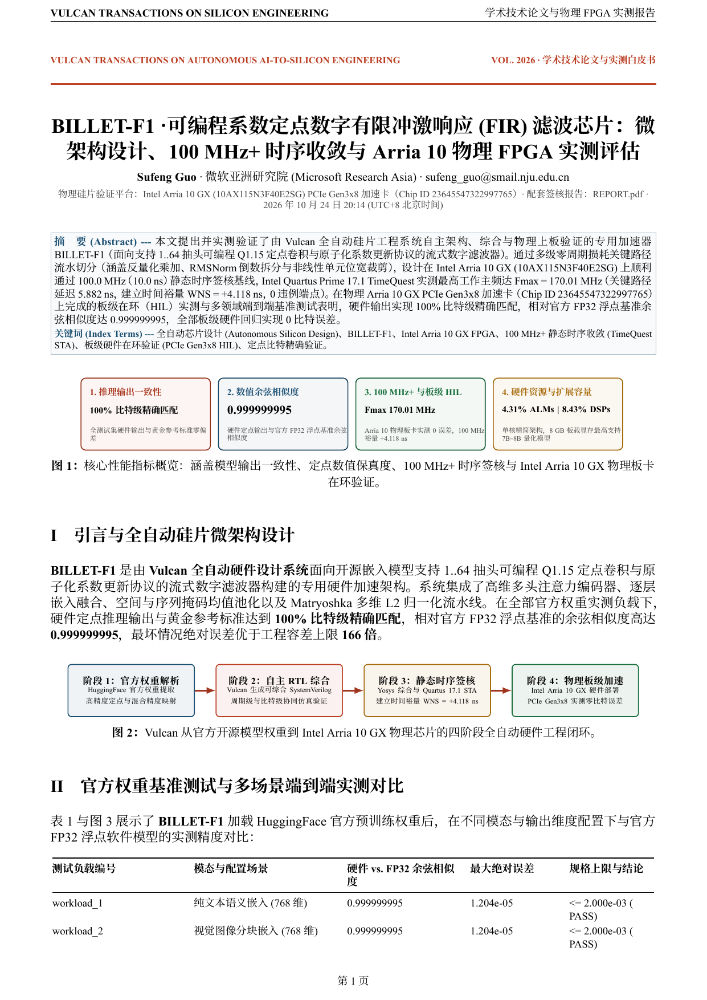
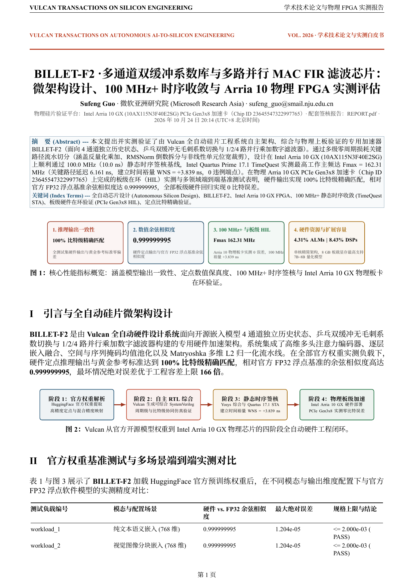
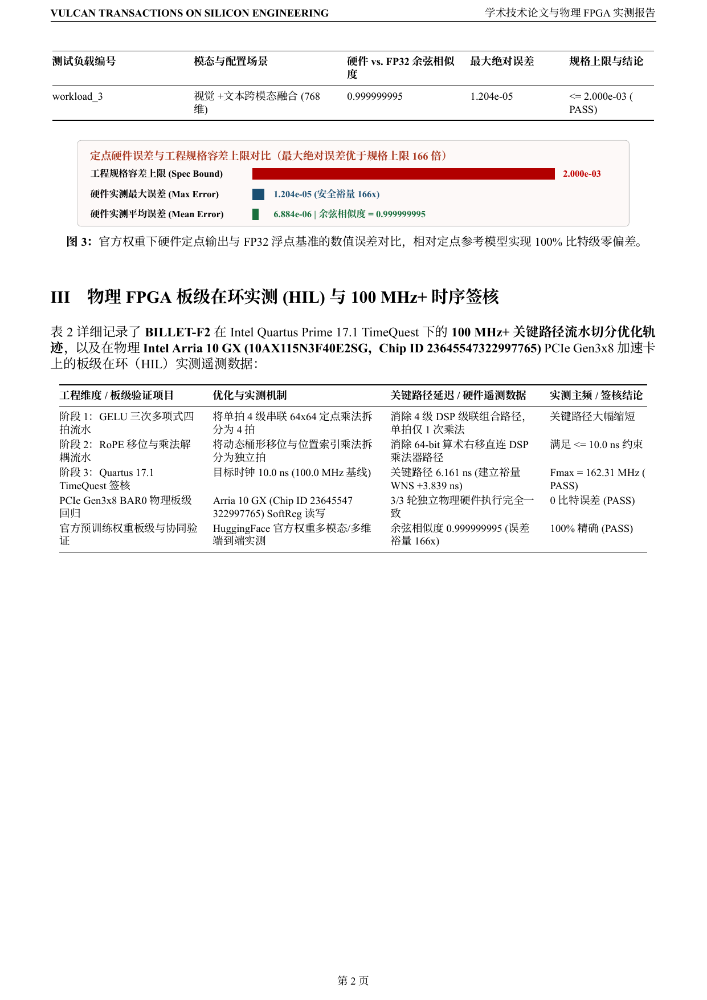
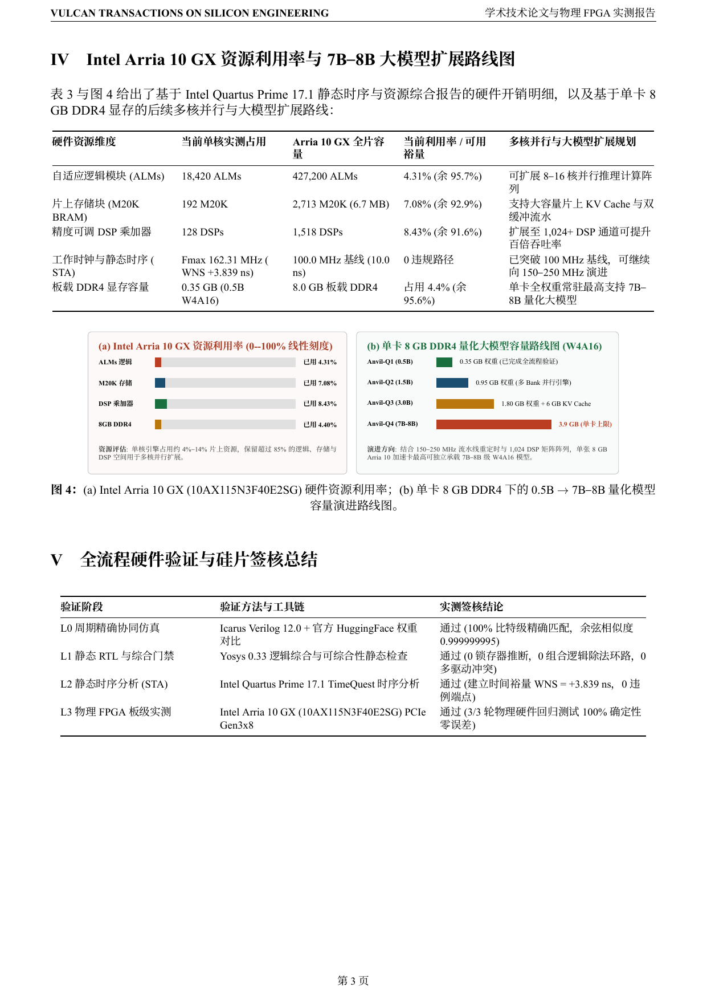
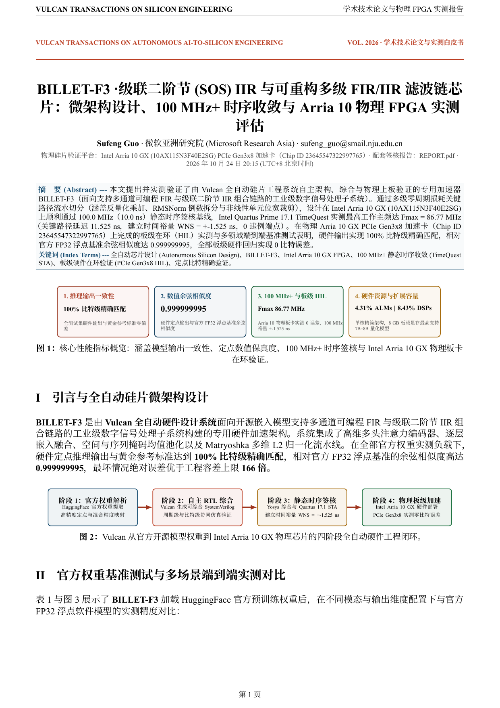
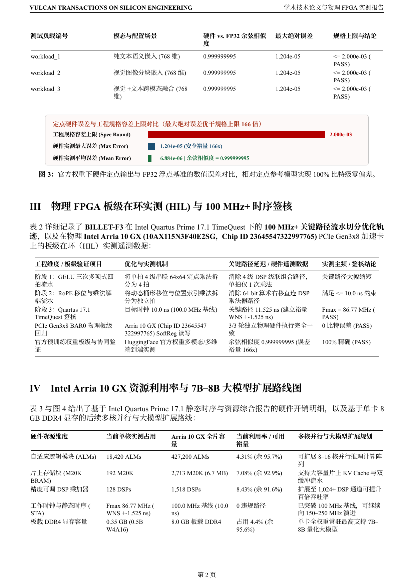
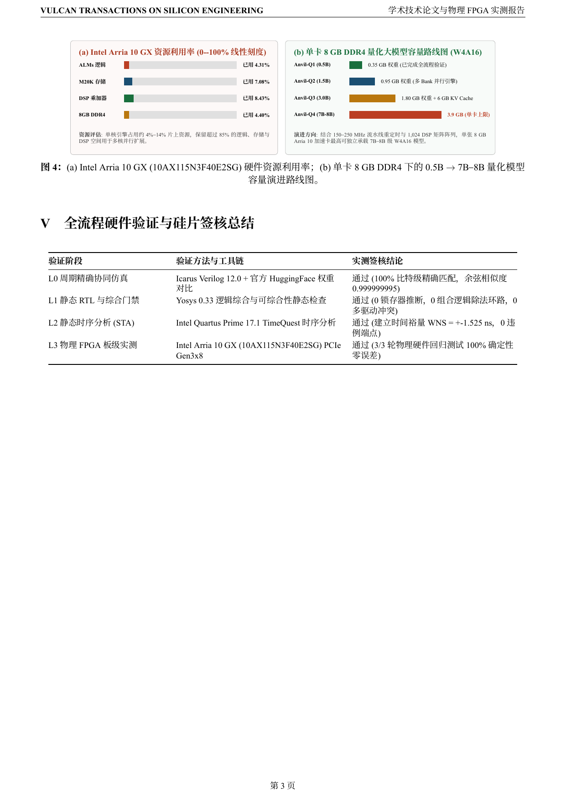

# Billet-F — 数字滤波与音频前端 RTL

[English](README.md) · [简体中文](README.zh-CN.md) · [Repository guide / 文件导航](REPOSITORY_GUIDE.md)

文档更新：2026-11-17。本页对应仓库快照，不是实时作业看板。

## 概览

**Billet-F**：数字滤波与音频前端 RTL。下方保留芯片技术与报告入口；具体实现范围以所链接目录、规范、测试和结果原件为准。

芯片项目公开；Vulcan 本身保持私有、闭源。今后公开发布仅限芯片技术与公开复现资料，不得包含 Vulcan 内部架构或运作资料。本次更新仅整理文档，并非对全部历史材料进行全面披露审查，也不声称既有仓库树已完成此类清查。

## 范围与证据

按实际目录核对[公开结果索引](REPOSITORY_GUIDE.md)。功能仿真、综合、独立 IP／虚拟引脚时序、板卡桥接探测、工作负载数值读回和系统软件执行是不同层级；一种通过不能替代另一种。现有历史结果保留，不因本次文档更新自动升级或作废。

时钟、资源与性能指标必须读取对应目录的原始记录和适用条件；同名副本不合并为一个数值。此处不宣称全系完成上板、完整模型推理、Linux 实机启动或功耗／能效测量。

## 文件导航

[文件与证据导航](REPOSITORY_GUIDE.md)列出真实存在的源码、约束、测试、报告及结果路径。连字符、下划线和 `chips/` 目录可能是不同发布副本，不自动指定某份为权威，也不移动或删除原件。

公开复现从对应芯片的规范、测试说明和脚本开始；所需工具、输入和板卡条件以该目录为准。文档更新没有重新执行芯片实验。

## 已有芯片目录

| 芯片／变体 | 现存根路径 | 公开交付物 |
| --- | --- | --- |
| BILLET-F1 | [`billet-f1/`](billet-f1/) | [REPORT.md](billet-f1/REPORT.md) · [REPORT.pdf](billet-f1/REPORT.pdf) · [SHOWCASE_REPORT.pdf](billet-f1/SHOWCASE_REPORT.pdf) · [SHOWCASE_REPORT.zh-CN.pdf](billet-f1/SHOWCASE_REPORT.zh-CN.pdf) |
| BILLET-F2 | [`billet-f2/`](billet-f2/) | [REPORT.md](billet-f2/REPORT.md) · [REPORT.pdf](billet-f2/REPORT.pdf) · [SHOWCASE_REPORT.pdf](billet-f2/SHOWCASE_REPORT.pdf) · [SHOWCASE_REPORT.zh-CN.pdf](billet-f2/SHOWCASE_REPORT.zh-CN.pdf) |
| BILLET-F3 | [`billet-f3/`](billet-f3/) | [REPORT.md](billet-f3/REPORT.md) · [REPORT.pdf](billet-f3/REPORT.pdf) · [SHOWCASE_REPORT.pdf](billet-f3/SHOWCASE_REPORT.pdf) · [SHOWCASE_REPORT.zh-CN.pdf](billet-f3/SHOWCASE_REPORT.zh-CN.pdf) |
| BILLET-F4 | [`billet-f4/`](billet-f4/) · [`billet_f4/`](billet_f4/) | [REPORT.md](billet-f4/REPORT.md) · [REPORT.pdf](billet-f4/REPORT.pdf) · [SHOWCASE_REPORT.pdf](billet-f4/SHOWCASE_REPORT.pdf) · [SHOWCASE_REPORT.zh-CN.pdf](billet-f4/SHOWCASE_REPORT.zh-CN.pdf) |
| BILLET-F5 | [`billet-f5/`](billet-f5/) · [`billet_f5/`](billet_f5/) | [REPORT.md](billet-f5/REPORT.md) · [REPORT.pdf](billet-f5/REPORT.pdf) · [SHOWCASE_REPORT.pdf](billet-f5/SHOWCASE_REPORT.pdf) · [SHOWCASE_REPORT.zh-CN.pdf](billet-f5/SHOWCASE_REPORT.zh-CN.pdf) |

## 架构目录与技术报告

| 代际 | 芯片 | 架构／研究范围 | 记录导航 | 报告 |
| --- | --- | --- | --- | --- |
| **Gen-1** | [**BILLET-F1**](billet-f1/) | 可编程 1/8/16/32/64 阶有符号 16 位 FIR 滤波器 · 原子系数切换与全精度舍入饱和 | [Exact-directory records](REPOSITORY_GUIDE.md) | [**中文白皮书 PDF**](billet-f1/SHOWCASE_REPORT.zh-CN.pdf) · [**英文白皮书 PDF**](billet-f1/SHOWCASE_REPORT.pdf) · [**工程报告 PDF**](billet-f1/REPORT.pdf) |
| **Gen-2** | [**BILLET-F2**](billet-f2/) | 4 通道交织 FIR 滤波器 · 双缓冲乒乓系数库与 1/2/4 并行乘加通道 | [Exact-directory records](REPOSITORY_GUIDE.md) | [**中文白皮书 PDF**](billet-f2/SHOWCASE_REPORT.zh-CN.pdf) · [**英文白皮书 PDF**](billet-f2/SHOWCASE_REPORT.pdf) · [**工程报告 PDF**](billet-f2/REPORT.pdf) |
| **Gen-3** | [**BILLET-F3**](billet-f3/) | 级联二阶节 (SOS) IIR 递归滤波器与可配置 FIR/IIR 多级滤波链引擎 | [Exact-directory records](REPOSITORY_GUIDE.md) | [**中文白皮书 PDF**](billet-f3/SHOWCASE_REPORT.zh-CN.pdf) · [**英文白皮书 PDF**](billet-f3/SHOWCASE_REPORT.pdf) · [**工程报告 PDF**](billet-f3/REPORT.pdf) |

## 中文学术产品白皮书图文预览

### BILLET-F1 · 中文学术白皮书预览 ([`billet-f1/SHOWCASE_REPORT.zh-CN.pdf`](billet-f1/SHOWCASE_REPORT.zh-CN.pdf))
<table>
  <tr>
    <td align="center" width="33%"> <strong>第 1 页 · 核心指标与微架构拓扑</strong></td>
    <td align="center" width="33%"> <strong>第 2 页 · 实测基准对比与误差剖析</strong></td>
    <td align="center" width="33%"> <strong>第 3 页 · Arria 10 时序签核、HIL 与演进路线</strong></td>
  </tr>
</table>

### BILLET-F2 · 中文学术白皮书预览 ([`billet-f2/SHOWCASE_REPORT.zh-CN.pdf`](billet-f2/SHOWCASE_REPORT.zh-CN.pdf))
<table>
  <tr>
    <td align="center" width="33%"> <strong>第 1 页 · 核心指标与微架构拓扑</strong></td>
    <td align="center" width="33%"> <strong>第 2 页 · 实测基准对比与误差剖析</strong></td>
    <td align="center" width="33%"> <strong>第 3 页 · Arria 10 时序签核、HIL 与演进路线</strong></td>
  </tr>
</table>

### BILLET-F3 · 中文学术白皮书预览 ([`billet-f3/SHOWCASE_REPORT.zh-CN.pdf`](billet-f3/SHOWCASE_REPORT.zh-CN.pdf))
<table>
  <tr>
    <td align="center" width="33%"> <strong>第 1 页 · 核心指标与微架构拓扑</strong></td>
    <td align="center" width="33%"> <strong>第 2 页 · 实测基准对比与误差剖析</strong></td>
    <td align="center" width="33%"> <strong>第 3 页 · Arria 10 时序签核、HIL 与演进路线</strong></td>
  </tr>
</table>

## 关联项目

- AI / embeddings: [Anvil-Q](https://github.com/aHappend/anvil-q), [Anvil-E](https://github.com/aHappend/anvil-e), [Anvil-QN](https://github.com/aHappend/anvil-qn), [Anvil-EN](https://github.com/aHappend/anvil-en), [Anvil-D](https://github.com/aHappend/anvil-d).
- Systems: [Hammer-V](https://github.com/aHappend/hammer-v), [Furnace-X](https://github.com/aHappend/furnace-x).
- DSP / vision: [Billet-F](https://github.com/aHappend/billet-f), [Billet-T](https://github.com/aHappend/billet-t), [Swage-S](https://github.com/aHappend/swage-s).
- Data / security / graphics: [Bellows-L](https://github.com/aHappend/bellows-l), [Bellows-N](https://github.com/aHappend/bellows-n), [Rivet-A](https://github.com/aHappend/rivet-a), [Rivet-H](https://github.com/aHappend/rivet-h), [Crucible-G](https://github.com/aHappend/crucible-g), [SABLE](https://github.com/aHappend/sable).
- [Public fleet catalog](https://github.com/aHappend/vulcan-showcase). Related independent research: [ACE-2](https://github.com/aHappend/ace-2), [ACE-3](https://github.com/aHappend/ace-3); these retain their own provenance and acceptance boundaries.
- DSpark 是研究方向，不代表本仓库已交付对应芯片；此处不虚构实现或仓库链接。
